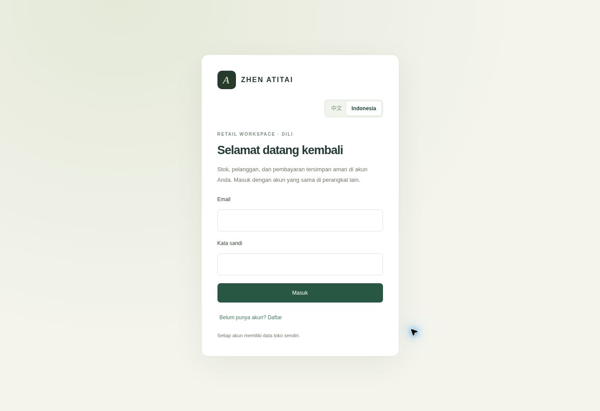

# ZHEN ATITAI

Workspace toko iPhone dalam **Mandarin dan Bahasa Indonesia**, dibangun ulang dari `ZHEN_ATITAI_Inventory_ZH_ID.html`.



Tampilan dan alur kerja asli dipertahankan: stok berdasarkan IMEI, pelanggan, penjualan eceran/grosir/cicilan, penerimaan pembayaran, sisa tagihan, jatuh tempo, filter, ekspor CSV, dan cadangan JSON.

## Jalankan

Node.js 22.18+ disarankan. Tidak perlu `npm install`, CDN, atau bundler pihak ketiga.

```bash
npm run dev
# buka http://localhost:5173

npm run check
npm test
npm run build
```

Hasil build:

- `dist/index.html`: aplikasi cloud satu file, siap dihosting sebagai situs statis.
- `dist/offline.html`: alternatif offline satu file. Bisa dibuka langsung di browser; data hanya disimpan pada browser tersebut.

## Supabase yang tersambung

- Akun koneksi: **YE CHANGZHEN**.
- Organisasi: `tzxmkmoeyxjxnudeywcj`.
- Project: **ZHENATITAI**, `kvjczrpkcwcgyxfxxxgs`, region Singapura.
- [Dashboard project](https://supabase.com/dashboard/project/kvjczrpkcwcgyxfxxxgs).
- Tabel: `public.atitai_records` dengan Row Level Security.
- API: Edge Function `atitai-api` memvalidasi pengguna dan aturan transaksi di server.
- Konfigurasi publik: `src/config.js`. Publishable key boleh berada di frontend; akses data tetap membutuhkan token pengguna dan dibatasi RLS. Service-role key tidak digunakan di frontend atau repository.

Daftar atau masuk dengan email dan kata sandi. Jika diminta, konfirmasi email dari Supabase, lalu kembali ke aplikasi untuk masuk. Jika aplikasi dihosting di domain baru, atur **Site URL** dan **Redirect URLs** di Supabase Authentication agar tautan konfirmasi kembali ke domain tersebut.

**Data terpisah per akun.** Masuk dengan akun yang sama pada perangkat lain lalu gunakan **Muat ulang** untuk mengambil data terbaru. Tidak ada sinkronisasi realtime otomatis atau berbagi data antar akun berbeda. Konflik penyimpanan bersamaan ditolak agar catatan terbaru tidak tertimpa.

File HTML yang diunggah tidak membawa data dari browser lama. Data offline lama tetap di browser asal dan tidak otomatis dikirim ke Supabase.

## Struktur

```text
src/app.js           Tampilan dan interaksi toko
src/auth.js          Halaman login/pendaftaran bilingual
src/cloud.js         Supabase Auth, refresh session, dan koneksi API
src/core.js          Validasi stok, penjualan, dan pembayaran
src/storage.js       Akses cloud atau penyimpanan offline, cadangan JSON
src/i18n.js          Terjemahan Mandarin–Indonesia
src/config.js        URL project dan publishable key
styles/app.css      Tampilan asli dan halaman login responsif
vendor/             Runtime React yang disertakan dalam HTML asli
supabase/           Skema database dan Edge Function
scripts/            Server development, pemeriksaan sintaks, build
tests/              Aturan transaksi, kompatibilitas data, dan API
```

Source antarmuka memakai fungsi runtime JSX (`jsx` / `jsxs`) agar dapat diedit dan dijalankan langsung sebagai JavaScript standar. Library React dari file sumber disertakan lokal; lihat `THIRD_PARTY_NOTICES.md`.

GitHub Actions memeriksa sintaks, menjalankan tes, dan membangun dua file HTML sebagai artifact. Workflow tidak mengaktifkan hosting otomatis.

## Verifikasi

17 tes otomatis lulus, termasuk aturan transaksi, kompatibilitas penyimpanan lama, isolasi request API, dan konflik versi. Tampilan login bilingual serta alur tambah perangkat → pelanggan → penjualan diuji di browser. API Supabase aktif dan menolak request tanpa login. RLS diuji langsung pada database dengan transaksi yang di-rollback: pemilik dapat membaca datanya dan akun lain tidak; Security Advisor tidak menemukan masalah. Login dengan akun pengguna sungguhan dan penyimpanan lintas perangkat memerlukan akun pertama yang didaftarkan pengguna.

## 中文

保留原有库存、客户、销售、分期、收款及导出功能，支持中文和印尼语。云端版本使用 Supabase 邮箱登录，每个账号拥有独立数据；在其他设备使用同一账号并刷新即可查看最新记录。`dist/offline.html` 为本地离线备用版本，不与云端同步。
